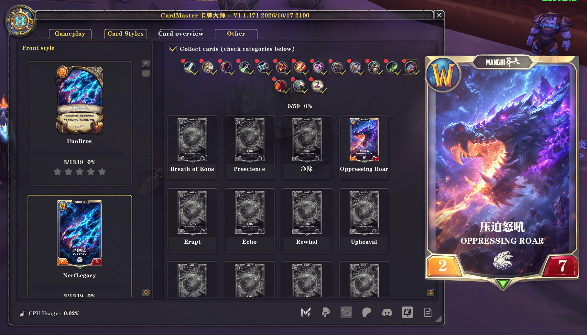
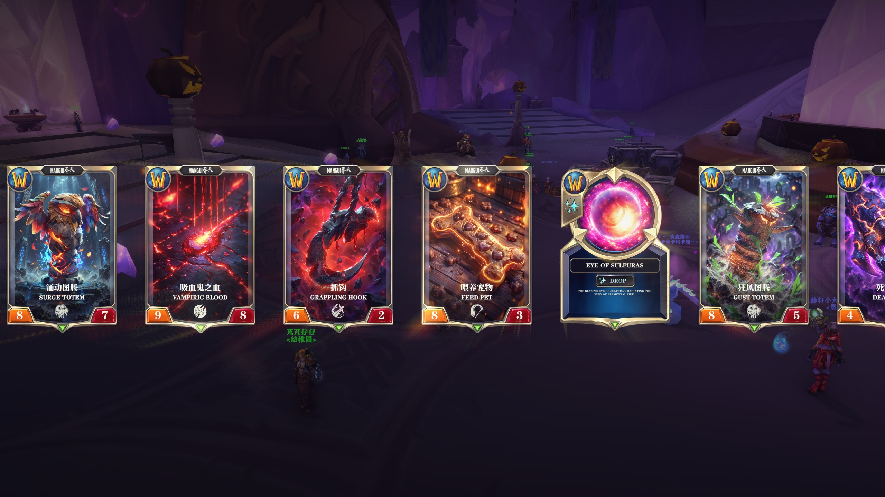
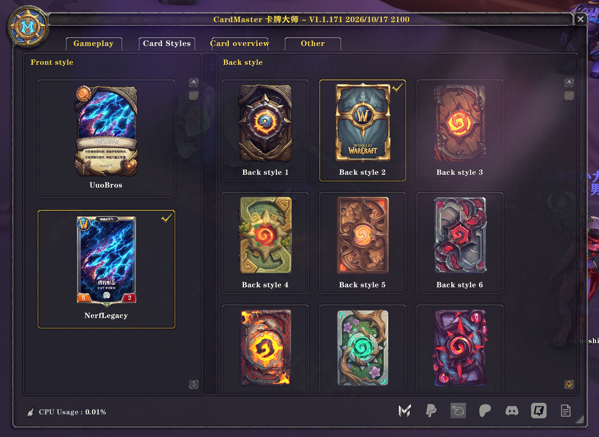
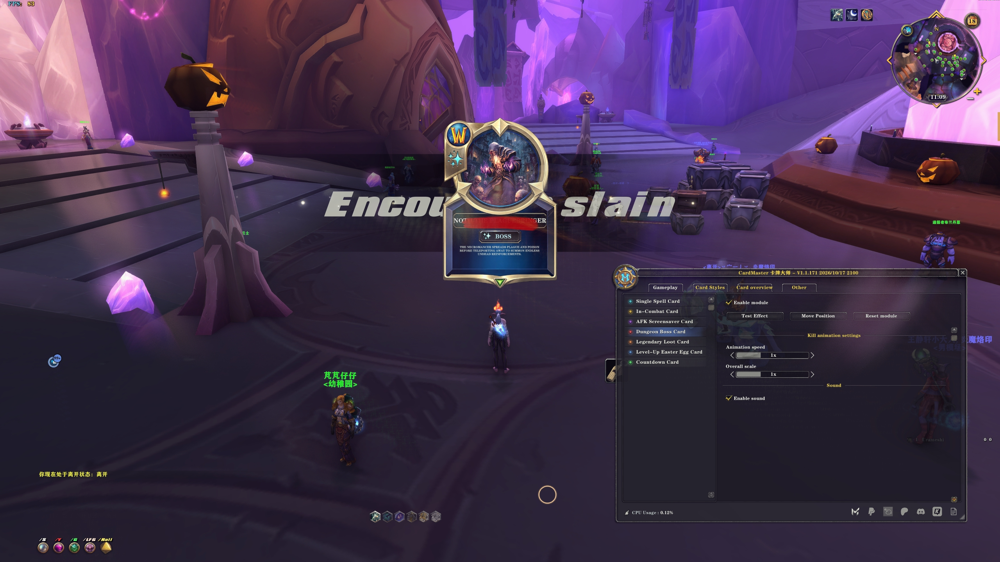
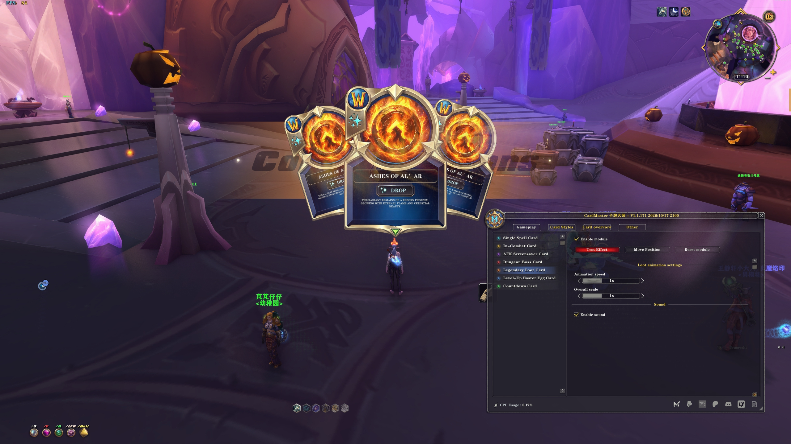
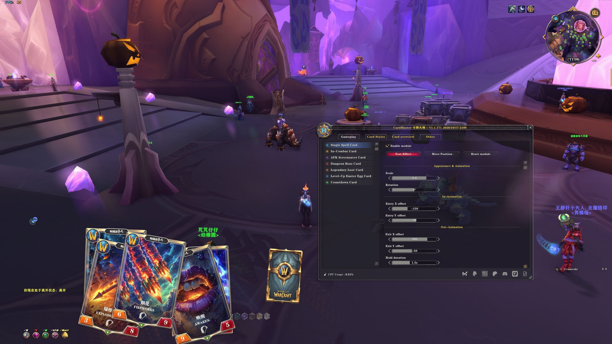
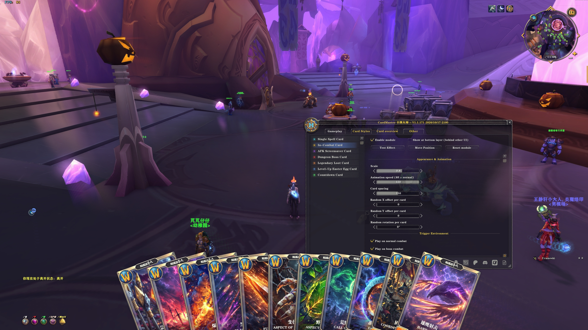
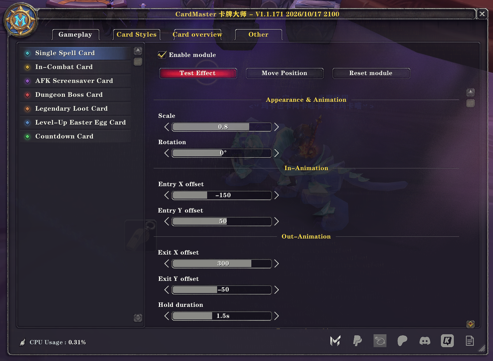
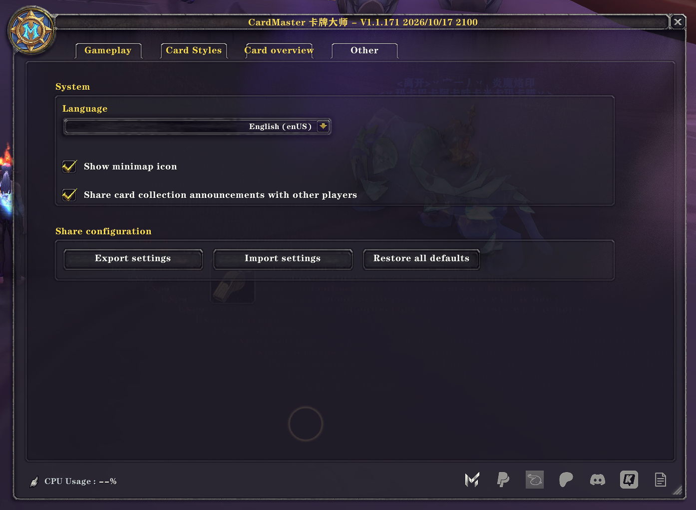

# CardMaster

**English** · [简体中文](README.zh-CN.md)

**Every adventure could bring your next collectible card.**

CardMaster is a World of Warcraft addon inspired by the card presentation style of Hearthstone. It transforms class abilities, bosses, and other in-game content into distinctive cards, bringing a more visual, collectible, and immersive experience to your adventures in Azeroth.

**Card collecting is a core part of CardMaster.** Discover new cards as you play, watch your collection grow, and build your own card gallery of Azeroth.

## Collect Cards as You Adventure

Combat, quests, gathering, fishing, dungeons, raids, and battlegrounds can all help you grow your collection.

Enable collection, select the categories you’re interested in, and take part in eligible activities during normal gameplay for a chance to earn new cards. Each successful collection reward grants one random card from your selected pool. **Cards you already own are never awarded again.**

Complete your favorite class first, focus on boss cards, or work toward both complete sets. Whether you prefer exploring on your own or adventuring with friends, your everyday gameplay can bring you closer to completing your collection.

**Give every quest, battle, and discovery a little more anticipation.**

## Watch Your Collection Grow

- **Two independent collections:** Track UuoBros and NerfLegacy separately.
- **Choose what to collect:** Select the sets and categories you want to pursue.
- **Detailed progress:** View completion progress for individual categories and entire card sets.
- **Instant reward notifications:** Receive a local message and sound when you collect a new card.
- **Card browsing and previews:** Explore the card gallery, or hover over and click card names in reward notifications to preview them.
- **Shared character progress:** Characters on the same account within the same game client share collection progress.
- **Group collection progress:** View teammates’ set progress when addon communication is available and they use a compatible version.

## A Massive Hand-Drawn Card Collection

CardMaster currently includes **two complete card sets, totaling 2,678 cards**.

Each set contains **1,339 cards**, covering abilities from every World of Warcraft class, bosses, and more, with content drawn from across the history of the game.

**Every single card was personally drawn and created by me, one card at a time.**

The two sets offer different visual styles and their own collection goals. More card sets, styles, and content will continue to be added in future updates.

*A gallery of cards inspired by adventures across Azeroth.*

*Choose your card-front style and card back.*

## More Features

- Hearthstone-inspired card interface and animated presentation
- Card effects for ability casts, entering combat, AFK, bosses, item loot, leveling up, and countdowns
- Adjustable card positioning, scale, and animation settings
- Selectable card fronts and backs
- A clean, intuitive presentation designed to blend naturally with the World of Warcraft UI
- Chinese and English interface support

### Cards in Action

*Boss card presentation.*

*Loot card presentation.*

*Spell card animation and positioning.*

*Entering-combat card presentation.*

### Make It Your Own

*Adjust card placement, scale, and animation.*

*Chinese and English interface support, with configuration import and export.*

## Installation and Getting Started

Install CardMaster through CurseForge, then enable the main addon and its included collection and card-set modules in your game’s addon list.

Once in game, type **`/cm`** or click the minimap button to open settings. In the card gallery, enable **“Collect cards”** and select the categories you want to collect.

Fully exit and restart the game after installing for the first time or updating to a release that adds new modules.

## Compatibility

Supported game versions are listed on this CurseForge project page.

The card collection features content inspired by World of Warcraft across its history. Available features and activity detection may vary between game clients. Collection progress does not automatically synchronize between different clients.

## Feedback

If you encounter a bug, have a suggestion, or would like to request a new feature or card style, please leave feedback on the CurseForge project page.

## Disclaimer

CardMaster is an independent fan-made addon and is not affiliated with or endorsed by Blizzard Entertainment.

World of Warcraft and Hearthstone are trademarks of Blizzard Entertainment, Inc.

---

**English** · [简体中文](README.zh-CN.md)
