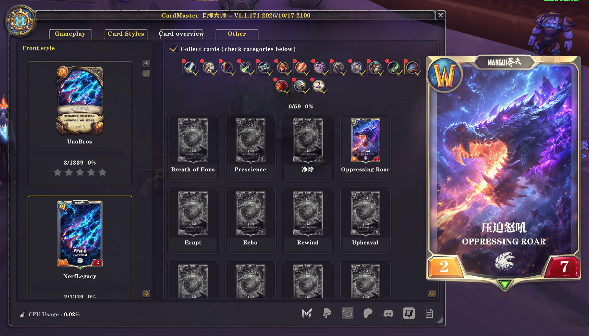
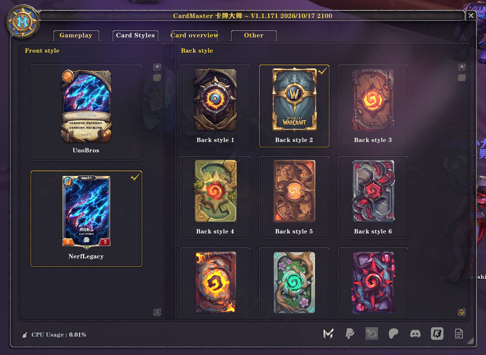
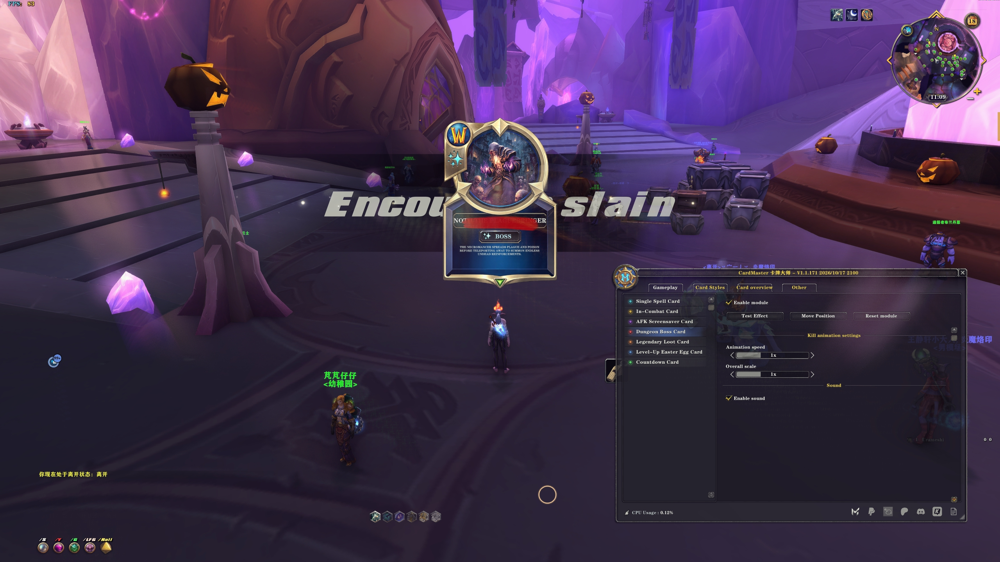
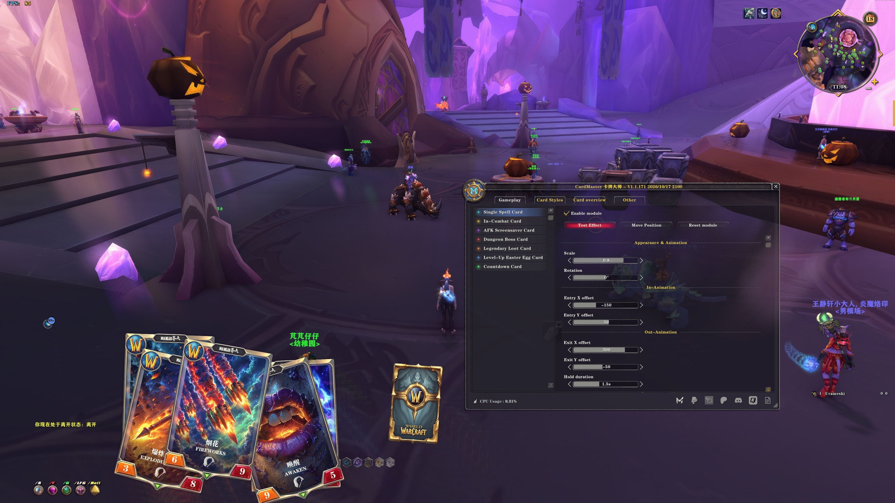
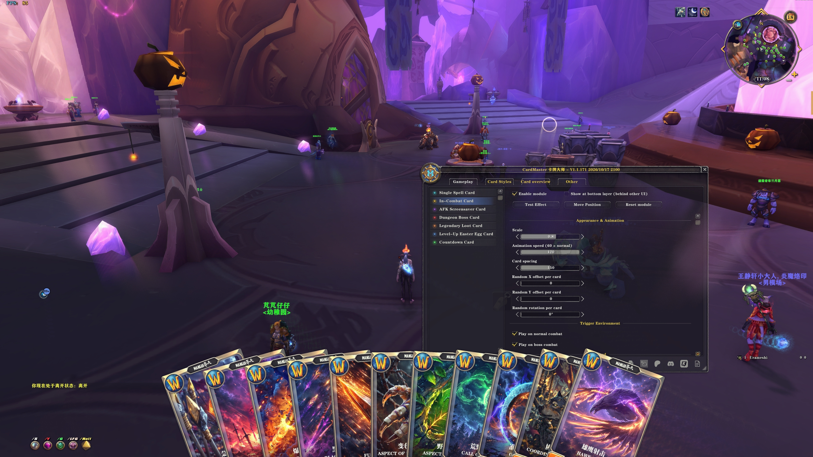
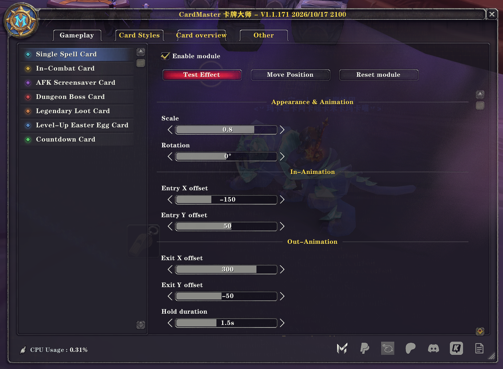
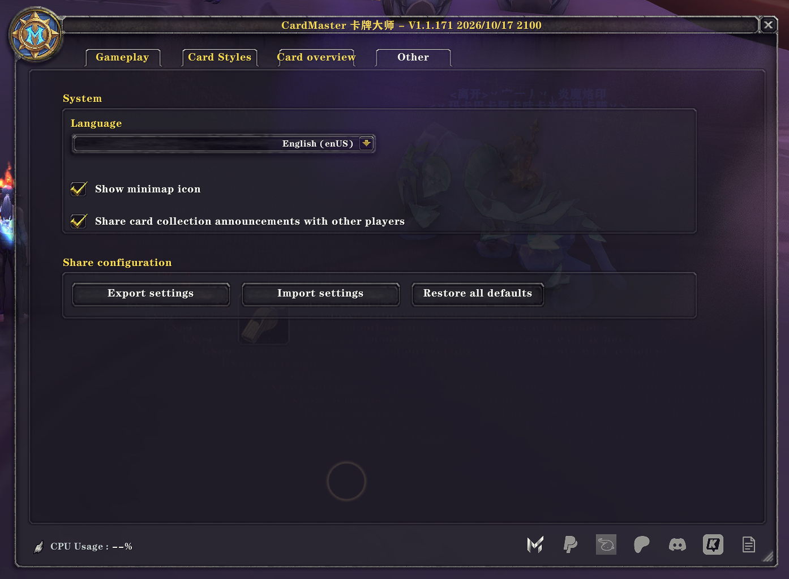

# CardMaster · 卡牌大师

[English](README.md) · **简体中文**

**让每一次冒险，都有机会成为你的下一张收藏。**

CardMaster 是一款受到《炉石传说》卡牌展示风格启发的《魔兽世界》插件，将职业技能、首领和其他游戏内容呈现为独具特色的卡牌，为你的艾泽拉斯之旅增添更生动、更具收藏乐趣的体验。

**卡牌收集是 CardMaster 的核心玩法之一。** 在日常冒险中获得新卡，逐步填满你的收藏，打造属于自己的艾泽拉斯卡牌图鉴。

## 在冒险中收集卡牌

战斗、任务、采集、钓鱼、副本与战场，都可以成为你获得新卡的途径。

开启收藏并选择感兴趣的分类后，正常参与符合条件的游戏活动，就有机会获得尚未收藏的卡牌。每次成功获得收藏奖励，都会从你选定的范围中随机授予一张新卡，**不会重复获得已有卡牌**。

你可以先集齐最喜爱的职业，专注收集首领卡牌，也可以向两套完整收藏发起挑战。无论你喜欢独自探索，还是与朋友并肩作战，都能在熟悉的游戏过程中逐步积累收藏。

**让任务、战斗与探索，多一份期待。**

## 看得见的收藏进度

- **两套独立收藏：** I 圣铸系列 与 II 流光系列 分别记录收藏进度。
- **自由选择收藏范围：** 按套牌和分类，选择你想要收集的卡牌。
- **分类与套牌进度：** 随时查看各分类及整套卡牌的完成情况。
- **新卡即时提示：** 获得卡牌时，通过本地文字通知与提示音及时反馈。
- **卡牌浏览与预览：** 浏览卡牌图鉴，也可通过获卡通知中的卡名悬浮或点击预览。
- **角色共享收藏：** 同一账号、同一客户端下的角色共享收藏进度。
- **队友进度互查：** 在客户端允许插件通信且队友使用兼容版本时，查看队友的套牌收藏进度。

## 大规模原创手绘卡牌

CardMaster 目前包含 **两套完整卡牌，共 2,678 张**。

每套拥有 **1,339 张卡牌**，涵盖《魔兽世界》所有职业的技能及首领等内容，创作素材横跨游戏各个版本。

**每一张卡牌，都是我亲自一张一张绘制和制作完成的。**

两套卡牌提供不同的视觉风格，也带来各自独立的收藏目标。未来还将持续加入更多套牌、风格与内容。

*取材于艾泽拉斯冒险的卡牌图鉴。*

*自由选择卡面风格与卡背样式。*

## 更多特色

- 《炉石传说》风格的卡牌界面与动态展示
- 技能施放、进入战斗、AFK、首领、物品掉落、升级及倒计时等卡牌反馈
- 可调整卡牌位置、大小与动画表现
- 可选择卡面与卡背样式
- 清晰直观、自然融入《魔兽世界》的界面
- 中文与英文界面支持

### 游戏中的卡牌效果

*首领卡牌展示。*

*物品掉落卡牌展示。*

*技能卡牌动画与位置调整。*

*进入战斗卡牌展示。*

### 按你的喜好调整

*调整卡牌位置、大小与动画表现。*

*支持中文与英文界面，以及配置导入和导出。*

## 安装与开始收藏

通过 CurseForge 安装 CardMaster，并在游戏插件列表中启用主插件及随包提供的收藏与卡牌模块。

进入游戏后，输入 **`/cm`** 或点击小地图按钮打开设置。在卡牌总览中启用 **“开始收藏”**，勾选想要收集的分类，即可开始你的收藏之旅。

首次安装或更新新增模块后，请完全退出并重新启动游戏。

## 兼容性

支持的游戏版本以本 CurseForge 项目页面列出的版本为准。

卡牌内容取材于《魔兽世界》历代版本。各客户端可用的功能与活动识别方式可能有所不同，不同客户端之间的收藏进度不会自动同步。

## 反馈

如果你遇到问题、有功能建议，或希望看到新的卡牌风格，欢迎在 CurseForge 项目页面留言。

## 声明

CardMaster 是独立制作的粉丝插件，与暴雪娱乐不存在关联，也未获得其背书。

《魔兽世界》与《炉石传说》均为暴雪娱乐的商标。

---

[English](README.md) · **简体中文**
